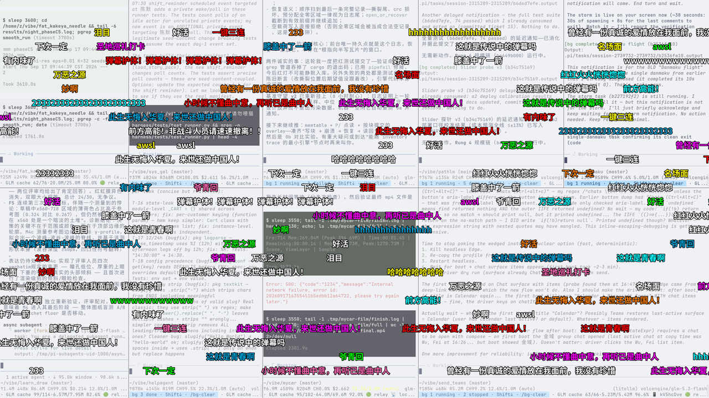

<p align="right">English | <a href="README.zh-CN.md">简体中文</a></p>

<p align="center"></p>

<h1 align="center">danmaku</h1>

<p align="center"><sub>A tiny PyQt5 danmaku engine for X11</sub></p>

<p align="center"><b>Bilibili-style comments fly across your desktop — transparent, always on top, and click-through.</b></p>



<p align="center"><i>Storm demo at t=16&nbsp;s on a 2560×1440 desktop. The whole layer is click-through, so the
terminals underneath keep working.</i></p>

## Quick start

You need Python 3, PyQt5, an X11 session, and a CJK font. The demos default to
`Noto Sans CJK SC` (`fonts-noto-cjk` on Debian/Ubuntu); `danmaku.py` also takes
`--font FAMILY`.

```bash
git clone https://github.com/ZisIsNotZis/danmaku.git
cd danmaku
python3 -m pip install -r requirements.txt
python3 danmaku.py
```

One comment crosses the screen in 10 seconds, then the overlay removes itself.
Your own text and timing:

```bash
python3 danmaku.py "前方高能！" --duration 6 --font-size 48 --vertical 0.5
```

No window frame, no background, no taskbar entry: only outlined text, moving
right to left, while clicks reach whatever is underneath.

## What it can do now

- **One comment on demand.** `danmaku.py` takes the text, font, point size,
  crossing time and vertical position as arguments.
- **Timed feeds.** `danmaku_engine.py script timeline_test.json` plays a JSON
  timeline in real time; entries can be small or large, white or colored.
- **An embeddable engine.** `Engine.push(text, color, size)` is the API, and
  `danmaku_engine.py daemon` keeps the engine alive for code that hosts it.
- **Tight lanes.** Comments enter the topmost lane that can take them without
  overlap, and the gap closes exactly when the leader leaves.
- **Large comments.** A large comment occupies two lanes (falling back to small
  when no band is free), so it never collides with the line below.
- **Click-through by design.** Qt's `WindowTransparentForInput` plus a raw
  X11 input-shape fallback; the verification scripts print the empty shape.
- **A storm demo.** `danmaku_storm.py` floods the screen at ~15 comments/s on
  one fullscreen window — the reference model the engine was compared against.
- **Reproducible captures.** Three scripts launch a demo, inspect the window and
  grab frames with `ffmpeg`; `verify_engine.sh` also samples engine CPU time from
  `/proc`.

## Architecture

The engine avoids the usual fullscreen repaint. The obvious version — one
translucent ARGB window redrawn at 60 fps — spends every frame clearing and
painting the whole screen. Here each comment is rasterized **once** into its own
tiny pixmap-backed window; the timer only moves those windows, which X11 turns
into `XMoveWindow` requests. No re-rasterization, no per-frame text layout.

Two rules keep the lanes clean:

- Every comment crosses the screen in the same fixed lifetime `T`, so speed
  grows with width: `speed = (W + w) / T`.
- A lane admits a new comment only when
  `delta >= T * max(w_new, w_last) / (W + max(w_new, w_last))`. The gap reaches
  zero exactly as the leader exits, so lanes stay tight without catch-up
  collisions. Checking the lane's most recent comment is enough by transitivity.

`danmaku.py` and `danmaku_storm.py` use the same click-through mechanism: an
empty X11 input shape, set through Qt and re-applied with
`XShapeCombineRectangles` as a fallback.

| File | Role |
| --- | --- |
| `danmaku.py` | One-shot overlay; the smallest complete example. |
| `danmaku_engine.py` | Lane allocation, large comments, pixmap windows, timeline player and daemon. |
| `danmaku_storm.py` | High-density storm on one fullscreen window. |
| `timeline_test.json` | Sample feed: small, large, colored and burst comments. |
| `verify_*.sh` | Launch, inspect and capture each demo. |
| `assets/logo.svg` | The mark above. |
| `docs/project-status.md` | Milestone evidence, design decisions and boundaries. |

## How to develop

There is no build step, lockfile, CI or test suite. The demos and the three
verification scripts are the test harness.

```bash
python3 danmaku.py                    # one-shot overlay
python3 danmaku_engine.py script timeline_test.json --duration 30
python3 danmaku_engine.py daemon      # engine alive for embedding code
python3 danmaku_storm.py              # ~15 comments/s for 30 s
```

To inspect and capture:

```bash
./verify_flight.sh    # -> shot_t2.png, shot_t5.png
./verify_engine.sh    # -> eng_t6.png, eng_t20.png, CPU samples
./verify_storm.sh     # -> storm_t6.png, storm_t16.png, storm_t26.png
```

The scripts need `ffmpeg`, `xwininfo` and `xdpyinfo`; `verify_engine.sh` also
uses `xdotool` when it is installed. Set `DISPLAY` if your session is not `:1`,
and `PYTHON` if `python3` is not the interpreter with PyQt5. Running them
rewrites the committed capture files.

The X11 input-shape calls mean the overlay is X11-only; it does not run on
Wayland or other display servers.

## How to contribute

Small fixes and portability patches are welcome; see
[`CONTRIBUTING.md`](CONTRIBUTING.md). Keep changes X11-native, keep the runtime
dependency list at PyQt5, and run the relevant verification script before
opening a pull request. The project is licensed under AGPL-3.0.

## Roadmap

### Implemented

- One-shot overlay with text, font, size, duration and position options.
- Engine v2: per-comment pixmap windows, tight lane packing, two-lane large
  comments, timeline playback and a daemon API.
- Storm reference model on a single fullscreen window.
- Click-through via Qt plus the raw X11 shape fallback.
- Verification scripts and committed captures for all three demos.

### Planned

Nothing. This is a closed milestone (2026-09-29), kept complete and working
rather than actively developed. The AI/roast overlay that once lived here moved
to [Backseat](https://github.com/ZisIsNotZis/backseat); no AI code remains.

### Future vision

If someone picks the project up, the meaningful next step is Wayland through
`wlr-layer-shell`, which would replace the X11 shape calls rather than wrap
them. A thin feed adapter — JSON lines over stdin or a local socket — would make
the daemon useful without embedding Python. Neither is planned or promised here;
the current engine is complete for what it set out to do.

## License

[GNU AGPL v3](LICENSE.md), © 2026 ZisIsNotZis.
